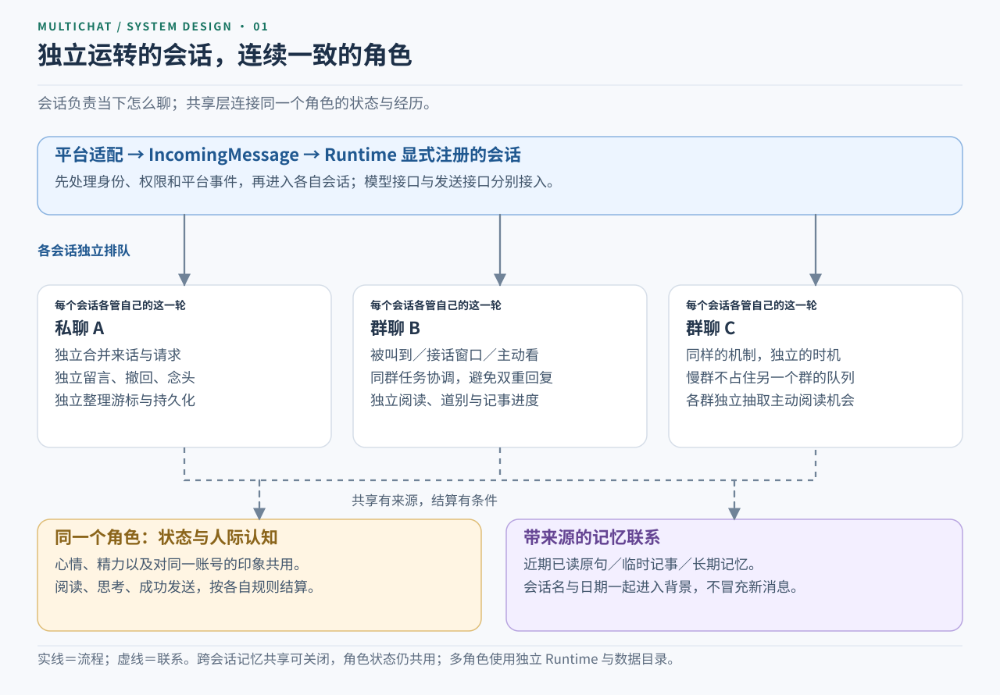
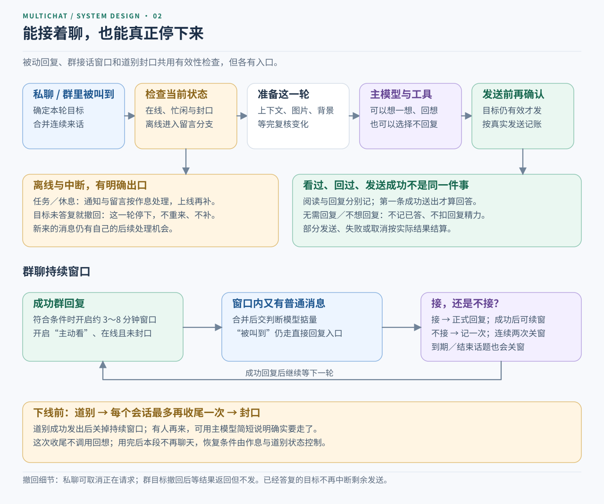
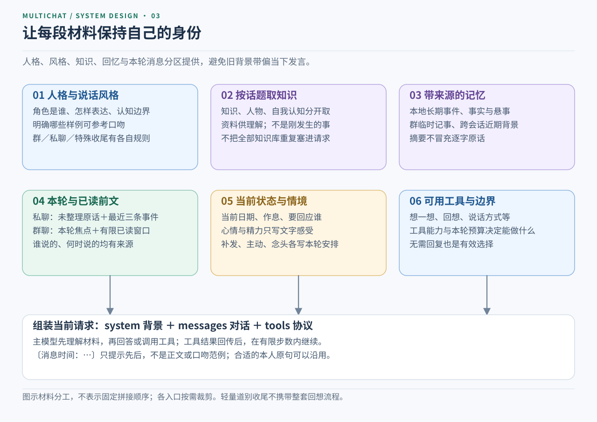
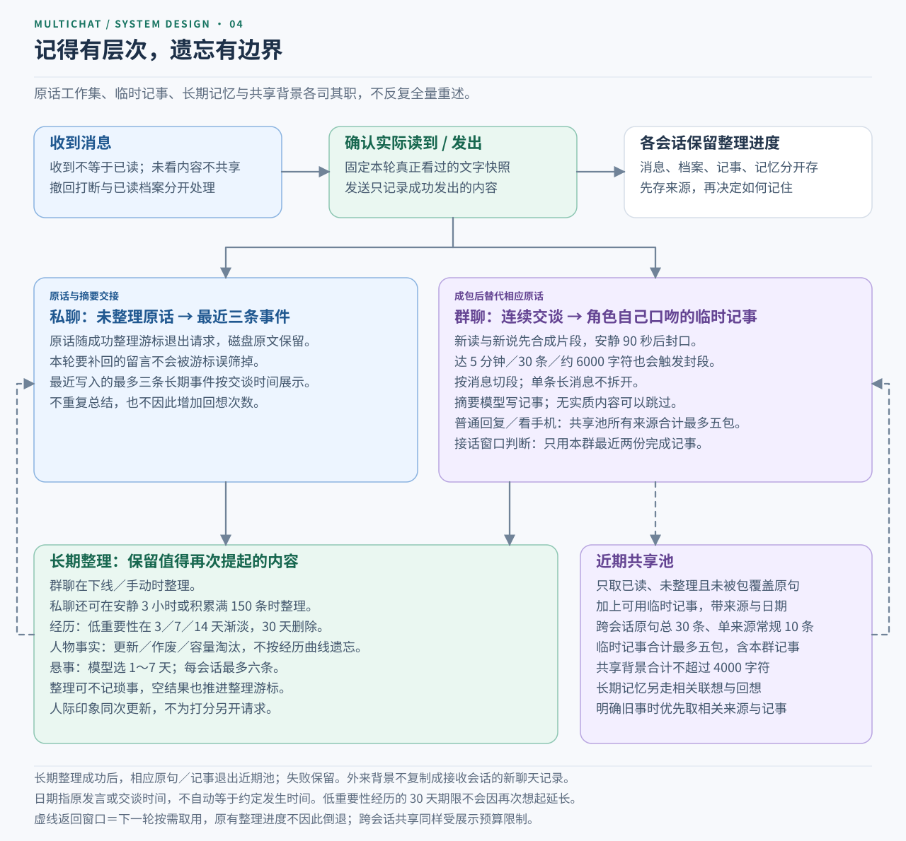
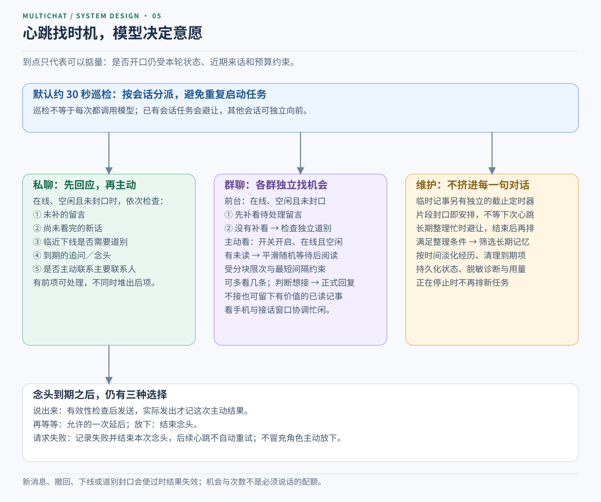

# Fireflyflame-MultiChat-Frame 多会话框架

## “足够复杂的逻辑设计无异于魔法✨”

**⚠️ 本架构由于提示词较长，工具请求较为频繁，对模型能力要求较高且至少需要支持工具调用，前期测试发现deepseekflash，kimi k2.8这类中小模型尚不能实现较好效果，当然，如果你设定的提示词较少，或许也有比较ok的结果，若想获得良好体验，请使用k3、GPTsol、Claude Sonnect这类体量大/性能优异的模型。**

一个角色，同时生活在多个会话里。每个私聊、群聊独立处理消息，通过带来源的记忆和近期记事保持连贯。

以及：类人记忆系统，遗忘曲线，知识库系统，精力系统，认知系统，作息系统，精心设计的对话逻辑，三层认知系统，提示词工程等等。

**==全部依靠提示词，tooluse，本地嵌入模型实现。==**

***==目标是做体验最好的聊天架构==***

当前版本：**v0.1.0**。这是供开发者接入的平台无关框架。原本是给astrbot+napcat做的插件，这份是整理出的框架，本框架Python 核心不依赖 AstrBot、NapCat 或 QQ；补充提示词，接好模型接口即可接入自己的agent。随包有离线演示、可选 AstrBot 模型适配器和默认本地浏览器仪表盘。

**从哪里开始：** 先看下面的机制图，再按 [Agent 配置与接入指南](docs/AGENT_SETUP.md) 填角色、模型、平台和运行目录；接口细节见 [接入说明](接入说明.md)。

## 环境要求

| 用途 | 要求 |
| --- | --- |
| 框架、终端演示、本地仪表盘 | **Python 3.11+，建议 3.12.x**；**NumPy ≥1.24**（见 `requirements.txt`） |
| 完整验收／可选内置向量服务 | **Node.js 24.x**；普通框架运行和本地面板不需要 Node |
| Python 环境管理 | **建议使用 uv**，先检查已有解释器与依赖，不直接改系统环境 |

先只读检查用户现有环境；满足要求就复用。若缺少合适的 Python 或依赖，建议用 uv 在**框架目录的 `.venv/`** 建立独立环境，安装与运行均明确使用该环境的解释器。不要覆盖已有 `.venv`、升级系统 Python／Node 或向全局环境安装包。uv 管理 Python，不负责安装 Node。

环境检查、Windows／Linux／macOS 命令和已有环境的处理见 [Agent 环境与配置指南](docs/AGENT_SETUP.md)。目前实际验收环境为 Windows、Python 3.12.12、Node 24.14.0。

## 先看整体，再看每个循环

**图中的蓝色是输入与会话流程，紫色是知识、记忆与模型判断，绿色是已确认的阅读／发送与记录，黄色是时机和状态边界。实线表示处理流程，虚线表示状态或记忆联系。** 图按当前代码简化，省略部分错误分支；点击图片可查看完整 SVG，文字可选取，无外部字体或脚本依赖。

### 总览：会话独立，角色连续

每个会话保留自己的队列、窗口和进度；同一个角色的状态与记忆通过明确的结算、来源和展示预算联系起来。

[](docs/diagrams/01-overview.svg)

### 对话循环：回复、续聊与自然结束

明确被叫到和窗口里的普通消息使用不同入口。接话成功可以续窗，道别后的收尾机会按会话分别计；“无需回复”是完成这轮判断的一种结果。

[](docs/diagrams/02-conversation.svg)

### 提示词组合：让资料保持身份

人物设定、口吻样例、知识、回忆、当前消息各有用途。来源与时间帮助理解背景；它们不能自动变成角色当前的发言或心情。图展示材料分工，不承诺所有入口固定使用同一拼接顺序。

[](docs/diagrams/03-prompt-composition.svg)

### 记忆循环：分层整理，按需联系

群临时记事消化连续交谈；长期整理筛选值得留下的事；共享池在整理之前连接已读内容。经历、人物事实和悬事有不同生命周期，人物事实不套用经历的遗忘曲线。

[](docs/diagrams/04-memory.svg)

### 后台循环：到点掂量，不强制发言

心跳按会话检查机会，先照顾留言与新话，再考虑道别、念头和主动联系。主模型决定表达意愿，程序约束忙闲、时机、频率和过时结果。

[](docs/diagrams/05-heartbeat.svg)

## 保留了什么

- **独立会话流程**：合并来话、等图、请求、分段发送、撤回打断、失败处理、离线留言和上线补发；一个慢会话不会挡住其他会话。
- **多群聊天**：被叫到、接话窗口、各群独立随机阅读；先判断是否参与，再正式回复。群里的已读、回复、翻过、留言分别记录。
- **可以自然停聊**：同一个不回复工具区分“无需回复”和“不想回复”。普通私聊、群回复和上线补发中，话题自然结束就可以停下；不因此假定生气或关系变差。
- **以角色口吻记事**：连续阅读与对话合并后生成短期记事，过滤琐碎和重复内容；长期记忆自动整理、按重要性随时间淡化，低重要性记忆最终删除。
- **带来源的跨会话联系**：近期已读内容、临时记事和长期记忆可以共享，保留账号、会话和时间标签；不会把别处的话冒充成本轮新消息。两个共享开关可分别关闭。
- **共享状态、独立流程**：同一角色的情绪、精力和对人的印象共用；每个会话的队列、正在请求、接话窗口、道别、阅读计数和留言独立。
- **可替换人设与资料**：身份、语气、边界放在 Markdown；知识、人物、风格库只有少量虚构样例，可改、可清空，不含原角色的完整剧情、私印象、账号或表情图片。
- **模型接口**：工具循环、必需工具结果补交、失败重试、脱敏诊断、用量统计均保留；工具回传和模型 SDK 转换放在适配层。
- **可配置作息**：每日在线时段、独立忙碌区间或全天在线；不带原来的虚构星球作息。
- **本地仪表盘**：状态、会话、记忆、人际印象、模型用量、必需工具成功／失败类型、未完成任务；`Runtime.start()` 默认启动在 `127.0.0.1:8765`，用浏览器查看，也可关闭后接宿主页面桥。

## 快速试跑

先按 [Agent 指南](docs/AGENT_SETUP.md) 检查环境。已有可用解释器和依赖时直接运行；不满足时推荐以下隔离方式。**在框架目录执行，且只在 `.venv` 不存在时执行创建命令**；已有目录先检查，不重建覆盖。

```sh
uv venv --python 3.12 .venv
```

Windows PowerShell：

```powershell
uv pip install --python .venv/Scripts/python.exe -r requirements.txt
.venv/Scripts/python.exe -I -B examples/console_demo.py
```

Linux／macOS：

```sh
uv pip install --python .venv/bin/python -r requirements.txt
.venv/bin/python -I -B examples/console_demo.py
```

无需激活环境。下文的 `python` 均指前面验证过的解释器：使用 uv 环境时，替换为对应的 `.venv/Scripts/python.exe` 或 `.venv/bin/python`。依赖准备完成后，演示本身不需要模型 Key、QQ、AstrBot、Node 或外网。

演示通过真实核心流程处理一个私聊与一个群聊，模型回复由脚本固定提供；输出只打印在终端，状态写入演示自己的临时目录。这能验证框架连接，不代表真实模型的角色效果或某个平台已完成适配。

浏览器仪表盘演示使用假的模型与本地数据，不需要平台账号或模型 Key：

```sh
python -I -B examples/dashboard_demo.py
```

程序保持运行，在浏览器打开终端显示的本地地址，按 `Ctrl+C` 退出；不会自动打开浏览器。默认端口是 `8765`，可用 `--port 8766` 改端口，或 `--port 0` 让系统分配空闲端口。上面的 `console_demo.py` 是短时终端演示，显式关闭仪表盘。

自己的宿主调用 `await runtime.start()` 时默认同时启动本地仪表盘，实际地址在 `runtime.dashboard_url`；`await runtime.close()` 一并关闭服务。配置 `"dashboard": {"enabled": false}` 可保留纯宿主桥，`"dashboard": {"port": 8766}` 可修改端口。服务只监听本机回环地址，不自动暴露到局域网或公网。

```sh
python -I -B tests/run_all.py
```

测试仅使用假的模型、平台和临时数据；任一测试失败时入口返回非零状态。详见 [验证记录.md](验证记录.md)。

## 接入自己的平台

核心入口是 `multichat.runtime.Runtime`。详细契约和短示例见 [接入说明.md](接入说明.md)。

1. 实现 `Transport`：发送文字、发送本地图片、输入状态。支持引用的平台处理 `reply_to`，不支持时可以忽略。
2. 实现 `ModelProvider.complete(ModelRequest) -> ModelResponse`，或包装现有 SDK。它接收系统提示、消息、工具定义及完整工具历史，返回正文、工具调用与可选用量。
3. 由宿主验证权限并过滤机器人自身消息，把平台事件转为 `IncomingMessage`；显式注册要接管的会话，未注册会话不接收。
4. 将撤回事件交给 `runtime.recall()`，用 `runtime.start()` 或宿主定时器调用 `tick()`，退出时等待 `close()`。

账号／群 ID 是稳定字符串，支持非数字及冒号。例如跨平台部署时可自行命名空间化为 `network-a:user:abc`，避免不同平台的相同 ID 混成一个人。相同人的跨平台身份关联应由宿主明确配置，框架不按昵称猜测。私聊会话 ID 必须对应参与者 ID。

`adapters/astrbot_model.py` 只是一个可选的模型适配实例；核心没有 AstrBot 白名单同步、QQ 指令识别、自动点赞或 NapCat API。那些属于宿主适配层，不是框架启动的前提。

## 改成自己的角色

- `config.example.json`：角色名、可选主要联系人、作息和共享开关的配置样例。真实配置与运行数据放在自己的数据目录，不提交账号、密钥或聊天记录。
- `prompts/identity.md`：身份和关系。只保留“小伴”的简短虚构示例。
- `prompts/voice.md`：说话风格。它也是短期总结的口吻依据。
- `prompts/boundaries.md`：认知边界、哪些设定不能凭空推断。
- `data/`：2 个知识场景、1 条自我认知、1 个人物、2 条风格样例，结构见 [data/README.md](data/README.md)。换角色时请同步改这些样例，改配置名字不会自动重写已有资料。
- `stickers/`：没有图片。用中文文件夹作为类别，见 [stickers/README.md](stickers/README.md)。

工具协议、消息来源标记、记忆筛选和发送状态规则仍在代码里；它们负责让功能运行，不要求每位用户从零写一套提示词。角色内容则由上述三个文件提供。普通回复长度随本轮来话调整，不设固定总条数。

主要联系人可不设。设定后固定亲密度 90，只更新印象，并允许使用主动联系等专属流程；它不自动表示恋爱或既有深厚关系。普通人从 60 开始积累印象。状态数字只供内部计算与仪表盘显示，不作为对话提示中的当前分数。

`decline_primary` 只控制对主要联系人主动“不想回复”，关闭仍保留自然“无需回复”；群里本轮只回应叫到角色的主要联系人时也遵循这个开关。功能需要模型支持工具，不额外调用一个判断模型。选择不回不发送正文、表情或理由，不记已回复、不扣该轮回复精力、不新增追问或念头；正常阅读与判断仍有自己的结算。分类保留在统计和记事中，原文不改。群里同时选 `end_topic` 才主动结束接话窗口，否则沿用未接计数。独立道别和最后一次收尾继续走既有专门流程。

## 数据与部署边界

- 一个 Runtime 对应一个角色，各会话共享这个角色的状态。不同角色请用不同 Runtime 和不同数据目录；人设上下文相互隔离。不要让两个 Runtime 同时写同一数据目录。
- 原始消息、状态、档案、记事包和记忆各有自己的文件；会话目录使用 ID 哈希，平台 ID 不直接变成文件路径。进程重启会恢复已注册会话和已持久化状态。
- 一次做到一半的发送／请求不会自动精确续播；仪表盘列出在途工作。已落盘的留言仍按核心规则补处理。
- 图片下载、文件大小／格式限制、平台消息顺序、幂等去重、权限名单和防机器人循环，由接入方负责；先用 `add_image()` 导入受信任的本地图片，再传其 attachment。
- 跨会话共享默认开启，适合受信任范围内的同一角色。提示词会提醒私聊来源，但这不是严格的数据隔离机制。需要硬隔离时分别关闭 `share_recent`／`share_memory`，或使用不同 Runtime 与数据目录。
- 默认样例使用本地字面检索。Node 和向量模型仅在你启用向量扩展时需要；现有样例没有预计算向量，不能只启动模型就声称样例库已具备语义检索。可选向量运行库说明见 `embed/NOTICE.md`。
- 网页通过 `window.MultiChatPage` 访问 `DashboardService`。默认本地 HTTP 服务提供浏览器接入，宿主也可关闭该服务后实现自己的桥与鉴权；不自动提供公网服务。页面桥与本地服务说明见 [pages/dashboard/README.md](pages/dashboard/README.md)。

## 目录

```text
multichat/           核心、端口类型、Runtime、状态和仪表盘服务
adapters/            可选 SDK 适配示例
prompts/             可替换人设样例
data/                精简知识／人物／风格／自我认知样例
pages/dashboard/    本地浏览器／可嵌入仪表盘
docs/               Agent 配置指南与可离线查看的 SVG 机制图
stickers/            空表情类别和添加说明
embed/               可选本地向量扩展及其第三方许可证
examples/            终端演示与常驻本地仪表盘演示
tests/               独立框架验收
```

## 后续计划

  - 群聊主动消息


## 向量模型来源

可选本地向量接口使用 Jina AI 提供的 **jina-embeddings-v2-base-zh**，用于将文本编码为向量，支持知识、记忆和风格的相似度检索。感谢 Jina AI 开源这款中英双语向量模型。

- 官方模型仓库：[Hugging Face · jinaai/jina-embeddings-v2-base-zh](https://huggingface.co/jinaai/jina-embeddings-v2-base-zh)。
- 模型许可：[Apache License 2.0](https://www.apache.org/licenses/LICENSE-2.0)，以官方模型卡的许可声明为准；模型由 Jina AI 提供，并非本框架自行训练。
- 当前接口读取官方仓库中的 [ONNX 量化模型](https://huggingface.co/jinaai/jina-embeddings-v2-base-zh/tree/main/onnx)（`onnx/model_quantized.onnx`）及配套分词器。本仓库不附模型权重，默认虚构样例使用字面检索；启用向量检索需另行准备模型及兼容的资料向量。

框架代码采用 [MIT License](LICENSE)，模型及运行库分别遵循各自许可。完整组件来源见 [第三方声明](THIRD_PARTY_NOTICES.md) 与 [向量服务说明](embed/NOTICE.md)。

## 相关项目与作者

- AstrBot 插件版：[超距通信：流萤丨Firefly Core](https://github.com/Harukuya/FireflyCore-Astrbot-Plugin)。面向 AstrBot + QQ（NapCat／OneBot）的流萤角色插件，包含角色设定与知识资料。
- 作者博客：[Noctuna · 关于我](https://www.noctuna.cc/about)。
